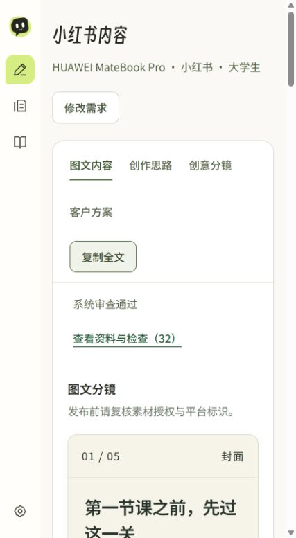
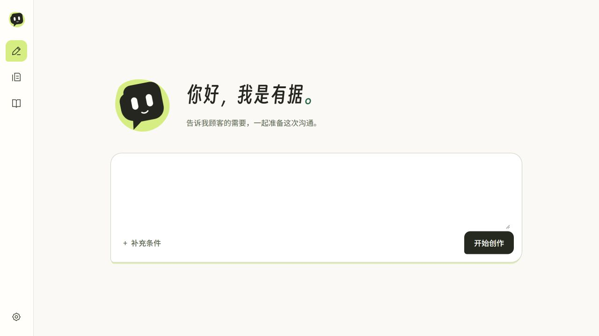
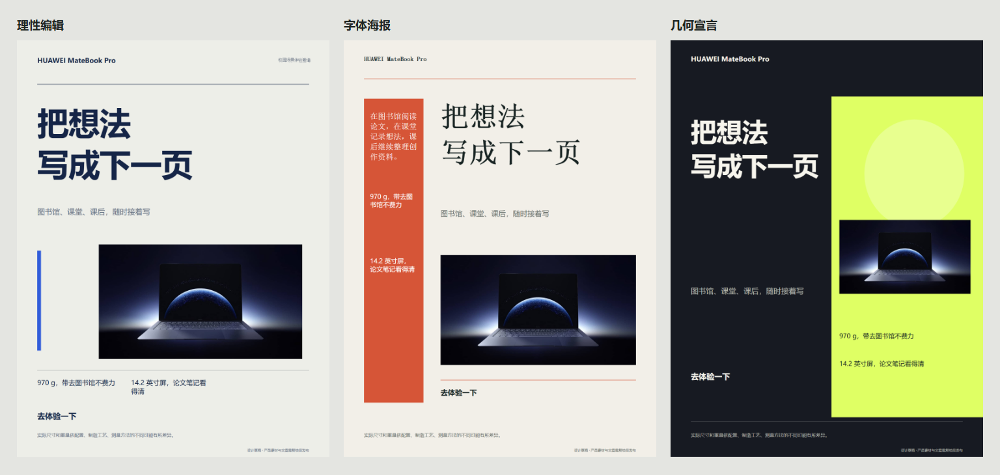

# MateQuill · 场景有据

杭州电子科技大学具身智能实验室 Shuuyou、6TDooo · 首届浙客松华为产业赛道初赛作品。

面向华为 PC 门店导购与内容运营，从顾客任务生成有产品依据的图文、分镜和销售沟通方案。

**评审演示入口：http://100.70.134.17:7860/**（按出题评委允许的自有服务器方式部署，需具备对应网络可达条件。）

## 已实现

- 单一自然语言输入，型号或目标顾客不明确时追问。
- 产品资料检索、官方事实与图片来源关联；正文生成、独立审校和一次修复复核。
- 小红书、公众号、朋友圈及海报内容；不同平台创意分镜。
- 可编辑矢量海报，文字、字体、间距、位置与颜色调整，PNG/SVG/JSON 导出。
- 顾客洞察卡、3分钟演示建议、1/3/7天跟进草稿。
- 文稿导出、当前会话任务恢复、异常重试。

## 真实运行结果

MateBook Pro／大学生／小红书：实际模型生成与审核通过，4张配图，复制及导出可用。





## 运行

Python 3.11+：

```sh
python -m venv .venv
# 激活虚拟环境后
pip install -r requirements.txt
python -m playwright install chromium
python -m uvicorn app.api:app --host 127.0.0.1 --port 8000
```

打开 http://127.0.0.1:8000，在本机设置中配置大模型连接，或通过 `.env.example` 对应的进程环境变量注入。真实凭证不在仓库。

公开仓库包含已采集的华为官方规格数据及图片元数据。赛事知识库原包和运行缓存未公开。完整复现图片需根据 `data/official_assets.json` 的 `image_url` 下载到对应 `path`，并保持SHA256一致；或由授权参赛者将赛事资料放入私有 `research/knowledge/`。评审服务器已配置实际资料与模型。

## 技术流程

自然输入 → 必要澄清 → 场景策略 → 产品事实/素材检索 → 模型生成 → 引用、型号、限定条件与图片检查 → 独立语义审校 → 最多一次修复与复核 → 文稿/海报导出。

FastAPI / Python，原生 HTML/CSS/JavaScript，OpenAI 兼容大模型接口，可选 ima 接入。系统提示词位于 `prompts/`。

## 本轮边界

四级价格组合与正式报价尚未实现；客户跟进为建议草稿，未连接 CRM 或实际发送。海报可编辑及导出已实现，独立 OCR 逐字验收尚未完成。未声称商业转化提升、全部任务成功或全部赛事要求已验收。

## 验证

```sh
pip install -r requirements-dev.txt
python -m pytest -q
node --check web/app.js
```

真实 API 与浏览器截图用于说明实际能力；Mock 回归测试不作为真实业务效果证明。
