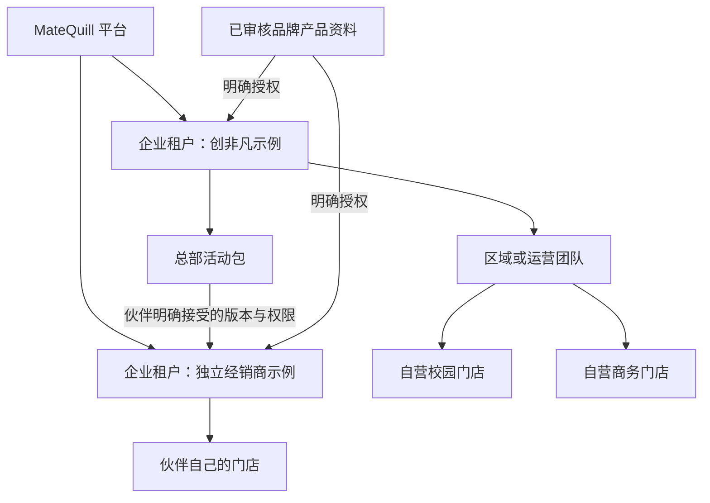
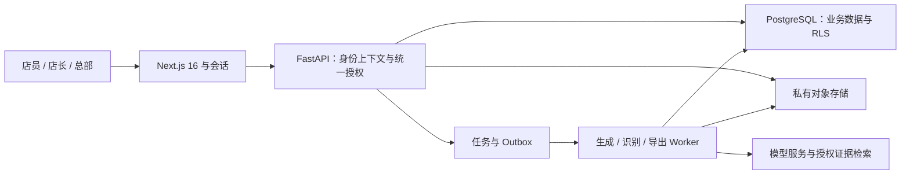

# MateQuill 多门店与多租户产品方案 v1

日期：2026-10-21。范围：代码现状核对、公开资料调研与拟议设计。本轮不修改应用代码、不迁移数据库、不改变线上部署。

## 1. 核心判断

目前 MateQuill 已有多门店画像、持久化推广计划和差异化方向规划，尚无企业级账号体系、组织权限及租户隔离。准确定位是“支持多门店数据的内容创作原型”。

下一步推荐将产品扩展为：**面向华为代理及其门店的内容经营工作台：总部组织活动，门店用真实场景完成创作，店长协作审核，业务团队了解执行与咨询反馈。**

多租户是这个流程的数据和权限基础；业务价值来自“总部到门店”的协作闭环。设计不假定创非凡现有组织、门店产权、内部系统或合作合同，以下企业与门店关系是待业务核实的建模假设。

## 2. 代码现状：已有能力和需要补齐的边界

| 范围 | 现状证据 | 拟补齐能力 |
| --- | --- | --- |
| 门店及活动 | `app/store_campaigns.py` 的 stores/campaigns/campaign_variants 无 tenant_id；`campaign_routes.py` 从全库读取门店 | 企业、门店、成员与资源归属 |
| 成稿 | `run_records.py` 的 runs 仅 id/body/created_at；全库最多保留 200 条；`api.py` 依据 run_id 读取和导出 | 按企业及门店授权读取、独立保留策略、导出审计 |
| 上传照片和录音 | `media_routes.py` 使用不透明 ID 获取文件，有 private/no-store，但没有账号归属检查 | 素材所有者、门店共享、授权下载与生命周期 |
| 海报 | `poster_routes.py` 使用全局内存索引和本地 JSON 文件 | 门店归属、版本协作、审核与下载权限 |
| 产品资料 | 公共产品库加全局确认入库；管理操作由本机连接条件限制 | 品牌共享库、企业资料、门店素材和审批角色 |
| 生成资源 | 进程级并发门和 IP 限流 | 企业用量、门店预算、公平队列与任务归属 |
| 身份与权限 | 已检查 API 未发现登录会话、组织成员或统一对象授权依赖 | 可靠登录、成员邀请、权限撤销、每次对象访问检查 |

不透明 UUID、浏览器私有缓存头、内网连接和前端隐藏菜单均不构成租户授权。对象级权限检查应覆盖内容本身及其预览、导出和衍生附件。这与 [OWASP BOLA](https://api-security.owasp.org/editions/2023/en/0xa1-broken-object-level-authorization/) 的风险分类一致。

## 3. 租户边界：企业、门店和伙伴分开建模

推荐租户表示独立经营、数据管理和服务合同边界；门店表示企业内的业务范围。一个用户可以属于多个企业、在多个门店拥有不同角色。

华为官方门店页面列出旗舰店、智能生活馆、授权体验店、全屋智能店等类型，说明渠道展示形式不同；这些分类不能直接推导门店产权或创非凡的管理范围。[华为官方零售页面](https://consumer.huawei.com/cn/retail/)

三条具体规则：

1. 创非凡的同一数据管理边界内，自营门店属于同一 tenant；区域、店组、门店作为授权范围。
2. 独立经销商拥有独立 tenant。代理上下游关系以 partner_relationship 和 campaign_grant 表达，不自动赋予查看客户、价格底稿或私有草稿的权限。
3. 华为品牌内容属于可授权的品牌资料域；不因为大家销售华为就建立一个所有门店互通的“大租户”。品牌运营方的身份和授权范围需实际确认。

门店后续转让或退出时，先终止成员和共享授权，按明确流程处理业务记录；不直接修改 tenant_id 将全店历史记录移交另一企业。

## 4. 四种工作界面，店员仍从一句话开始

| 使用者 | 默认工作界面 | 核心动作 |
| --- | --- | --- |
| 店员 | 本店创作首页 | 接收今天任务、拍照/语音、修改成稿、送审、取得发布素材 |
| 店长 | 本店内容与待办 | 审核、分配任务、维护真实门店信息和活动资格 |
| 区域/总部运营 | 活动与门店工作台 | 建活动、选范围、发资料、看进度、处理例外、复用经授权优秀案例 |
| 企业管理员 | 成员与设置 | 邀请员工、门店归属、授权、预算与审计 |

界面设计原则：

- 单门店店员登录后直接进入本店，不先填写企业、区域、门店三层表单。
- 顶部仅显示自然的“当前门店”入口；只有多门店成员可切换。切换后未完成输入先保存，并明确属于哪家店。
- 首页延续当前暖纸色、品牌字体和角色动效。重点是“今天可做的活动”和原有创作框，不引入复杂组织树或管理员仪表盘。
- 活动已提供产品、平台和截止时间时，直接继承；只追问本店未知的实拍、顾客问题或可用服务。
- 总部以“参与门店—待处理内容—执行结果”组织页面。详情按需展开，不把系统审计信息塞进店员主流程。
- 店员可以发起自主内容，不强制所有稿件来自总部任务；是否送审取决于企业策略和内容类型。

账号首期采用成熟认证组件及受控邀请流程，不自制密码与重置协议；企业微信接入作为业务确认后的下一阶段。可演示账号必须经过真实认证和服务器授权，角色选择器不能冒充登录。

## 5. 业务闭环：活动包到本店版本

建议将活动包定义为一个可追踪、可更新的正式业务对象，而不是一段共享提示词。

活动包包含：活动目标、产品准确 SKU/版本、适用区域和渠道、起止时间、已审核事实版本、可用图片及权利范围、门店资格、可编辑字段、禁止更改的品牌内容、审核策略和效果回收方式。

具体流程：

1. 总部创建“新品生态体验周”，选择自营门店范围，并向合作企业发出活动邀请。
2. 门店接收后，基于本店客群、当前任务、实拍和已有优选内容生成本地版本。
3. 店员说“今天家长问孩子上课怎么用”，系统形成对应选题，而非替换门店名字。
4. 内容保存为门店草稿；按策略由店长审核，明确修改意见与责任人。
5. 审核通过后得到平台适配的文案、配图或海报以及发布动作；初期支持复制/导出和真实发布记录。
6. 店员登记发布链接、截图或已完成状态；系统区别人工确认与平台接口确认。
7. 总部看到任务完成、采纳和回退情况；对独立合作企业，仅显示明确约定的统计或分享内容。

活动状态与稿件状态独立：活动可处于草拟、进行、结束、撤回；门店任务可处于待接收、创作、送审、需修改、已通过、已确认发布。已导出并不等于已发布，已发布并不等于成交。

事实或素材更新时发布新版本并通知受影响稿件。旧版记录保留审计；撤回的素材不能继续用于新生成。已经下载到外部的成品无法被服务器远程收回，产品应记录受影响发布并提供重新制作入口。

价格与权益单独维护：基础产品事实、企业活动、门店优惠、客户资格是不同数据，不用覆盖式提示词合并。每条规则保留来源、有效期、适用门店和组合条件，具体报价交给确定性规则计算；本期首先交付内容协作，不在临近复赛时同时重造完整交易系统。

## 6. 权限：角色决定动作，范围决定对象

| 角色 | 默认范围 | 可以做什么 | 不自动获得什么 |
| --- | --- | --- | --- |
| 企业管理员 | 自己企业 | 管成员、门店、角色、预算和企业配置 | 其他企业内容；默认代登店员 |
| 总部内容运营 | 指定组织范围 | 活动、品牌模板、企业内内容运营与被分享案例 | 合作企业的顾客和私有草稿 |
| 区域负责人 | 被分配区域/店组 | 管任务、看区域执行、处理授权审核 | 企业其他区域数据 |
| 店长 | 被分配门店 | 审核、店内协作、店员管理授权动作 | 其他门店私有数据 |
| 店员 | 自己与被分配门店 | 创建和修改自己的草稿、使用本店共享内容、送审 | 他人私人素材、组织管理 |
| 外部协作者 | 被明确授权对象 | 仅查看或编辑指定活动/版本 | 整个租户或组织树 |
| 平台运维 | 运行元数据 | 服务运维、租户状态与故障定位 | 常态浏览业务正文 |

采用 RBAC + 资源关系/范围检查 + 必要属性判断：用户角色、有效 membership、tenant、门店范围、对象所有者、状态、有效期共同决定授权。门店共享与个人草稿必须明确区分。

所有端使用同一授权语义：can(actor, action, resource, context)。前端按钮仅改善体验；FastAPI 是最终执行业务授权的位置。Next BFF、Server Actions 和后台 worker 也必须校验，不只检查首页会话。

组织成员被撤销后，下一个受保护请求即重新校验有效 membership；缓存和长连接在策略版本变化时失效。排队任务执行前、结果领取前各校验一次，不把旧登录令牌作为永久授权。

登录身份由认证系统确认，tenant/store 候选由客户端选择后仍由服务端核验。外部请求中的 X-Tenant-ID、JSON tenant_id 和工具调用参数不能直接成为权限依据。LLM 只能提出业务意图，不能扩大访问范围。

## 7. 知识与创作：共享事实，分开私有记忆

建议将证据与创作上下文拆为五层：

| 层 | 内容 | 共享规则 |
| --- | --- | --- |
| 品牌资料 | 已审核产品规格、正式图片、功能条件 | 显式面向指定租户/渠道开放，只读版本 |
| 企业资料 | 活动政策、品牌口吻、审核模板 | 本企业与被授权伙伴包 |
| 门店资料 | 地址、服务能力、有效优惠、真实环境照片 | 本店及获授权运营范围 |
| 个人工作资料 | 未共享照片/语音、私人草稿和修改习惯 | 创建者及明确协作者 |
| 经营反馈 | 采纳、修改、发布记录、可归因咨询事件 | 门店/企业按权限聚合；跨租户另行授权 |

检索先确定可访问的资料集合，再做型号/时效筛选和相关性排序；只把授权结果交给重排器或生成模型。原文、摘要、向量、引用、缩略图都继承访问规则。搜索索引中的权限字段不能代替真实身份校验。[Azure 检索安全过滤实践](https://learn.microsoft.com/en-us/azure/search/search-security-trimming-for-azure-search)

ima 或其他外部库只作为经过授权的连接器。无法表达用户级 ACL 的库只能放经过确认可向该连接受众共享的资料，或按租户分开连接；不能将不同企业私有材料塞进同一个无权限索引再靠提示词排除。

千店千面采用：**品牌约束 + 企业活动 + 门店任务画像 + 当次真实素材 + 本店授权历史 + 本批次差异化计划**。先规划题材、叙事与视觉，再写正文；事实层不通过提高温度来变化。

新店冷启动只需确认主要客群、常见问题和服务特色三个方面，可从已有门店档案带入。先使用品牌模板和经授权的聚合先验；有足够本店已采纳稿后，再检索相近任务作为风格参考。分享优秀稿需要明确授权，默认不跨租户学习原始正文。

## 8. 学术与业界证据如何使用

没有一个覆盖“华为代理多租户、渠道协作、千店千面”的统一 SOTA 榜单。应组合成熟权限架构、渠道营销产品实践和适合验证的个性化研究，而非宣称某篇论文解决整套问题。

| 依据 | 可借鉴内容 | 本项目的拟议决策 |
| --- | --- | --- |
| Google Zanzibar，USENIX ATC 2019 | 关系化授权与权限变更一致性 | 明确企业/门店/对象关系、撤权与结果读取一致性；不复制 Google 全套基础设施 |
| AWS SaaS 授权实践 | 登录、授权、隔离是不同层次 | 统一 TenantContext 与对象授权，同时落实存储隔离 |
| LaMP，2023/2024 | 从用户历史中检索相关材料用于个性化 | 检索本店已采纳稿和授权品牌案例，不以单一口吻标签代替历史 |
| DPWriter，2026-01 | 在规划阶段引入多样分支 | 借鉴规划多样性，先做无需训练的候选规划与选择；不声称已经复现其强化学习 |
| 小店 POP 人机协作研究，2026-03 上传 | 结合顾客理解、草稿与表达改进 | 让店员提供真实问题，快速微调；模拟 persona 只辅助评审，不能充当真实顾客反馈 |

来源：[Zanzibar](https://research.google/pubs/zanzibar-googles-consistent-global-authorization-system/)、[AWS 授权指南](https://docs.aws.amazon.com/prescriptive-guidance/latest/saas-multitenant-api-access-authorization/introduction.html)、[LaMP](https://arxiv.org/abs/2304.11406)、[DPWriter](https://arxiv.org/abs/2601.09609)、[小店 POP 研究](https://arxiv.org/abs/2603.29273)。论文实验效果不作为 MateQuill 的业绩或转化率。

商业产品方面，最直接的参照是分布式营销，而不只是通用 SaaS 后台：

| 官方实践 | 核心参照 | MateQuill 的采用方式 |
| --- | --- | --- |
| [Adobe Campaign Distributed Marketing](https://experienceleague.adobe.com/en/docs/campaign/automation/distributed-marketing/about-distributed-marketing) | 总部和本地单位通过活动包协作，控制可本地化范围 | 总部发布活动版本，各店拥有独立任务和内容，不只批量返回文案 |
| [Salesforce Distributed Marketing](https://help.salesforce.com/s/articleView?id=sf.mc_dm_distributed_marketing.htm&language=en_US&type=5) | 品牌营销内容交给伙伴、顾问等分布式使用者个性化 | 品牌事实固定，场景和表达允许门店创作 |
| [Adobe Express 品牌规模化](https://business.adobe.com/products/express-business/scale-on-brand-content.html) | 团队品牌资源与模板元素控制 | 品牌图形、必要参数固定，门店照片和故事可编辑 |
| [Sprout Social 审核工作流](https://support.sproutsocial.com/hc/en-us/articles/205974715-Message-Approval-Workflows) | 分开创作、审核和发布动作，保留审批记录 | 审批绑定内容版本，重要改动重新审核 |
| [Microsoft Dataverse 安全模型](https://learn.microsoft.com/en-us/power-platform/admin/wp-security-cds) | 业务单元、团队、角色与记录归属组合 | 一人可跨店任职，角色和数据范围独立建模 |
| [Adobe GenStudio Stateful Generation](https://experienceleague.adobe.com/en/docs/genstudio-for-performance-marketing/user-guide/create/stateful-generation) | 保留选定内容与上下文进行逐轮修改 | “短一点”“换开头”只改指定部分，保留已确认事实与门店信息 |

补充的 2026 个性化研究：[PURPLE](https://arxiv.org/abs/2601.12078)提示历史语义相关不等于对个性化有用，首期用已采纳、近期、同平台、同任务排序，积累反馈后再研究学习排序；[Pep](https://arxiv.org/abs/2602.15012)研究冷启动的高信息量追问，可借鉴为每次只问最影响结果的一项。二者用于提出可验证的产品假设，不在本方案中承诺训练或复现论文系统。

## 9. 推荐工程架构

保留 Next.js 16 + FastAPI，采用模块化单体，PostgreSQL 18 作为统一业务数据库，SQLAlchemy/Alembic 管迁移，S3 兼容私有对象存储管理素材。初期使用持久化 jobs/outbox 表与独立 worker；Redis 在需要共享限流、事件或成熟任务队列时引入。不是每家门店一套服务器。

候选业务实体：tenants、org_units、stores、users、memberships、role_bindings、partner_relationships、brand_workspaces、knowledge_versions、share_grants、campaigns、campaign_assignments、creative_runs、creative_versions、media_objects、approval_events、publication_records、usage_events、audit_events、jobs/outbox。

所有私有资源必须有非空 tenant_id；按业务加 store_id、owner_id、visibility、created_by、version、retention 字段。复合外键保证 campaign、store、media 等引用在同一 tenant 内；跨 tenant 共享经过独立 grant 和快照/版本引用，不直接伪造同租户外键。

数据库 RLS 是第二层保护：普通应用角色不拥有表，不带 BYPASSRLS；必要表启用 FORCE ROW LEVEL SECURITY，读写均设置策略。请求/任务事务使用局部上下文，连接池回收不能残留上一个 tenant。共享品牌资料单独建表或关系，避免用 tenant_id=NULL 隐式表示所有人可读。[PostgreSQL 18 RLS 文档](https://www.postgresql.org/docs/18/ddl-rowsecurity.html)

RLS 设计以可信后端设置上下文为前提，仍需防止 SQL 注入；数据库不能信任浏览器自行声明的租户。独立维护账号负责迁移，普通业务请求不使用超级用户权限。

RLS 不是模型、文件或整个系统的隔离保证。需逐项落实：

| 资源 | 拟采用规则 |
| --- | --- |
| API 与列表 | 从有效身份推导 tenant/scope；列表、总数、搜索建议也只返回授权信息 |
| 素材与导出 | 私有存储，服务端对象授权后下载；分享链接限定对象、有效期与撤销状态；内嵌 HTML/PNG 本身也算业务资产 |
| 缓存与 SSR | tenant + scope/权限版本 + 产品/知识版本组成键；私人响应不进入公共 CDN 或跨用户 SSR 缓存 |
| 队列 | 任务记录 tenant、actor、store 与预算；worker 重新授权，幂等键含 tenant；重试不会重复扣费 |
| 模型与对话 | 每次调用单独构造上下文，禁止全局混用会话/向量记忆；外部模型凭证服务端保存 |
| 日志与监控 | 记录 tenant、request、job、usage；正文和录音转写默认不进入日志；运维读取业务内容需临时授权并审计 |
| 用量 | 按 tenant/门店/任务统计 tokens、图片、ASR 时长和存储；公平排队，预留预算、成功结算、失败释放 |
| 生命周期 | 按租户配置保留、导出、删除与备份恢复；删除同步处理数据库、文件、向量和缓存；不继续全库统一删到 200 条 |

预签名 URL 是持有者可访问的授权凭据，在到期前通常不能靠退出应用即时撤销。敏感客户照片/录音优先经过每次鉴权的读取接口；普通宣传素材可使用短时签名，并明确撤权窗口。不能同时承诺“裸签名直链”和“成员撤权后所有旧链接瞬时失效”。[S3 预签名 URL 官方说明](https://docs.aws.amazon.com/AmazonS3/latest/userguide/using-presigned-url.html)

检索初期先在授权集合做精确搜索，数据量大且实测需要时再加 pgvector ANN。近似索引可能在扫描后应用过滤，影响结果数量和召回；必须单独测 tenant 过滤下的 recall/延迟，不能把 RLS 通过视为检索质量通过。[pgvector 官方说明](https://github.com/pgvector/pgvector)

首期授权用单一 authorize 接口和数据库关系实现，策略与测试集中维护；关系共享复杂后再接 OpenFGA/SpiceDB。Next 数据访问层统一会话与授权，但后端仍独立验证，不能只用路由重定向保护接口。[Next.js 身份认证指南](https://nextjs.org/docs/app/guides/authentication)

## 10. 两人团队的实现顺序

以下为工作量估算，不是完成承诺。复赛截止 10 月 23 日 17:00，优先做可验收的闭环，再扩展全量商业能力。

| 阶段 | 内容 | 放行条件 |
| --- | --- | --- |
| P0：首个垂直切片 | 登录/邀请、2 个真实隔离演示租户、各自门店、照片→成稿→海报→导出全链路归属，Postgres/RLS、迁移和跨租户测试 | 第二租户拿到第一租户 ID 仍无法读写、搜索、预览或导出 |
| P1：复赛业务闭环 | 总部活动包→门店差异化稿→店长审核→复制/导出→发布确认；演示显式伙伴活动授权；用量和审计基础 | 一次活动能追踪到不同门店任务、内容版本及真实执行记录 |
| P2：小范围试用 | 企微/SSO、精细预算、可恢复队列、版本更新通知、资料授权撤回、备份恢复、试用观察 | 明确的门店试用流程及持续运行验收 |
| P3：规模化 | 平台授权发布/数据连接、授权案例复用、基于反馈的选题优化、租户分片或独享部署 | 有实际流量、平台接口权限与业务需求支持 |

P0 建议 1–2 个开发日量级，P1 约 1–2 个开发日；可并行但集成和验收不可省略。当前时间窗口优先 P0 和 P1 的最短贯通路径；没有完成授权隔离就不对外宣称多租户。P2/P3 按试用反馈排期。

人员分工：一人负责身份、授权、存储迁移、worker 与隔离测试；另一人负责店员/总部体验、活动与审核流程、差异化创作和演示。共同先确认 TenantContext、资源归属、活动版本与权限矩阵，防止前后端各写一套定义。

迁移现有数据时先只读备份 SQLite 和素材清单，再导入明确标记的演示 tenant；未知归属数据不随意分给真实企业。保留现有产品事实与审阅记录，生成框架复用，不重写已通过验证的模型流程。

## 11. 验收与试用指标

必须覆盖的授权测试：不同企业、同企业不同门店、同店不同所有者、区域负责人、共享伙伴、撤销成员、过期授权、匿名用户、平台运维。对每类身份测试 list/get/create/update/delete、搜索、预览、导出、素材下载和后台任务。

特别测试：篡改 tenant/store/id、A 企业媒体用于 B 企业生成、修改海报引用他店成稿、缓存命中串店、队列延迟期间撤权、重试重复计费、知识向量/摘要泄露、SSE/流式结果、分享链接过期、连接池复用、跨租户外键、全局清理误删、活动授权变更后旧稿操作。

业务评估集建议先覆盖 3 类门店 × 3 个产品任务 × 2 个平台 × 2 类素材共 36 个情境，记录人工基线与系统辅助版本，另测 2 租户/跨店权限矩阵。考察：

- **省时**：店员主动操作时间、修改次数、一次完成率；生成等待与操作时间分别计量。
- **采纳**：最终稿采纳、送审退回原因、导出和真实发布确认；不能只统计生成量。
- **准确**：关键产品声明与有效资料一致、权益条件匹配、来源版本覆盖。
- **差异**：题材/叙事/视觉覆盖、语义近重复、店员盲评的本店适配度；避免只报 distinct-n。
- **经营**：带活动/门店/稿件归因的咨询事件；将人工登记、可验证平台事件和订单关联分开，不用点击直接推导增量成交。
- **隔离与稳定**：授权矩阵全部通过、权限撤销行为可验证；按租户看成功率、队列等待、P95 与单稿成本。

这些是拟议测量方法，尚无真实商用增益数据。后续有真实门店后可在同类门店内做分组或分时试用，再评估因果增益；模拟消费者评分只做候选筛选。

## 12. 复赛视频建议：把组织协作拍出来

建议新增 75–100 秒的业务故事：

1. 总部运营创建“新品生态体验”活动，分配校园店和商务店；合作企业只接收到被授权活动包。
2. 校园店员进入本店，拍一张真实照片，说一句顾客问题，直接得到本店稿。
3. 商务店用同一活动生成另一个顾客任务版本；并排展示题材与配图差异。
4. 店长批注一次，店员修改并获得可发布素材；完成发布确认，总部进度同步更新。
5. 切到合作企业账号，展示同一活动的独立执行空间；其私有内容不出现在创非凡工作台。

视频用真实角色会话和实际数据演示，组织数据均标注演示。让评委首先看到总部能组织、门店愿意做、成果能交付，再用简洁架构画面解释支撑能力。

## 13. 进入开发前需要业务核实的事项

方案目前按“自营与独立合作门店并存”设计，后续只需核实：

1. 创非凡实际管理哪些自营门店、哪些独立合作门店？总部对不同类型能看什么、能要求什么？
2. 谁负责内容审核，哪些内容可以免审？发布账号归企业、门店还是店员个人？
3. 目前最可信的执行记录与咨询数据来自哪里，是否已有企微/CRM/平台授权接口？

答案用于收敛产品范围和接入方式，不影响上述租户隔离原则。本轮到方案评审为止，不自动启动应用重构。
